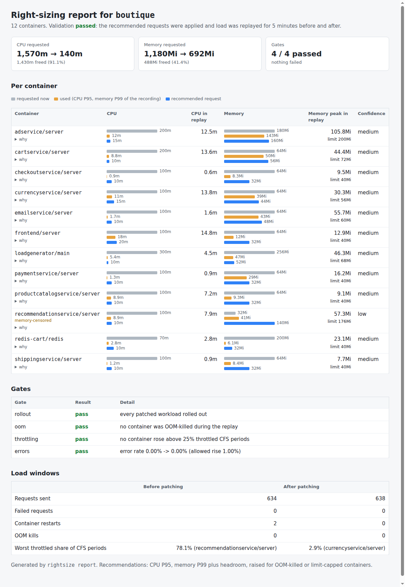

# kube-rightsize

`rightsize` is a small Python CLI that reads how much CPU and memory each container in a namespace actually used, from Prometheus, and suggests requests and a memory limit with a written reason for every number. On shared clusters, requests tend to get copied from the service next door and then doubled after the first OOM kill. I wanted them based on measurements, without being fooled by containers that were already starving.

It can also check its own advice. It applies the patches to a kind cluster, replays load, and fails if anything gets OOM-killed, throttled or starts returning errors. The result is a one-page report ([docs/index.html](docs/index.html)):



## Running it

You need Python 3.10 or newer. There are no runtime dependencies. pytest and Hypothesis are only used by the tests.

```sh
python3 -m venv .venv && . .venv/bin/activate
pip install -e '.[test]'
python3 -m pytest    # offline, against the committed recording
python3 -m rightsize recommend --from-recording recordings/boutique-30m.json --out out/recommendations.json
python3 -m rightsize patch    # one patch per Deployment in out/patches/, plus diff.txt
```

`recordings/boutique-30m.json` is 30 minutes of Google's Online Boutique demo on a local kind cluster with its load generator running. There's also a Docker image with nothing but the CLI in it:

```sh
docker build -t kube-rightsize .
docker run --rm -v "$PWD/recordings:/data:ro" kube-rightsize recommend --from-recording /data/boutique-30m.json
```

To record your own data or test patches under load you also need Docker, kind, kubectl and Helm 3:

```sh
scripts/up.sh --squeeze                       # kind + Prometheus + Online Boutique
WARMUP=120 DURATION=30m scripts/record.sh recordings/my-run.json
scripts/validate.sh                           # applies the patches, replays load, exits 1 if a gate fails
python3 -m rightsize report --run out/validate.json --out docs/index.html
scripts/down.sh
```

`validate.sh` takes about 20 minutes and builds the cluster itself if there isn't one. Or skip recording and point `recommend` at a live Prometheus:

```sh
kubectl -n monitoring port-forward svc/prometheus-server 29090:80 &
python3 -m rightsize recommend --namespace boutique --duration 10m --out live.json
```

Flags and file formats: [docs/cli.md](docs/cli.md). The two GitHub Actions workflows: [docs/ci.md](docs/ci.md). Cluster scripts and the workarounds my VM needed: [docs/cluster-setup.md](docs/cluster-setup.md).

## What it found on Online Boutique

Across the 12 containers, requested CPU goes from 1570m to 140m and memory from 1180Mi to 692Mi ([docs/boutique-results.md](docs/boutique-results.md)).

The interesting one is `recommendationservice`. `up.sh --squeeze` gives it a 40Mi memory limit, a bit under what it needs, so the recording has real OOM kills in it. Its P99 of 41.2Mi is just the limit plus noise, and a plain "P99 plus 10%" rule would have kept it crash-looping. Instead it gets flagged and raised:

```json
"reasons": [
  "Memory P99 is 41.2Mi over 132 samples; +10% headroom gives 45.3Mi.",
  "Memory is censored: OOM-killed 2 time(s), so the real peak is unknown. Raised to 140Mi (old limit +20% or +100Mi, whichever is larger) instead of trusting the percentile.",
  "CPU P95 is 8.9m over 108 samples.",
  "CPU raised to the 10m floor."
]
```

With all 12 patches applied, a 5-minute replay had no failed requests and no OOM kills. The unpatched baseline had 4 OOM kills and, which surprised me, no failed requests either. The frontend seems to just render the page without recommendations when that call fails, so only the OOM gate noticed. I also tried a deliberately undersized patch to make sure the gates can fail. They did. Details in [docs/validation.md](docs/validation.md).

## How it works

`rightsize record` runs range queries against the Prometheus HTTP API and saves the raw per-pod series (CPU, memory, throttling, restarts, OOM reasons, current requests and limits) as JSON. Everything after that can be recomputed offline, which is how the tests work.

`recommend` pools the replicas of each container and applies a fairly plain rule: P95 of CPU, P99 of memory plus headroom, a small floor, a memory limit a bit above the request, no CPU limit. The hard part was censored data. If a container was OOM-killed or sat at its limit, the percentile you measure is the limit, not the demand, and sizing from it shrinks exactly the service that is starving. Those containers get raised the way the Vertical Pod Autoscaler reacts to an OOM kill. Restarts caused a second problem: the CPU burst right after a container starts looks like throttling, so those samples are skipped. The full rules are in [docs/rules.md](docs/rules.md).

`patch` writes strategic-merge patches that only touch `resources`, and keeps existing CPU limits unless you pass `--cpu-limits drop`. `validate` compares a baseline load window with a replay after the rollout and checks four gates: rollout, OOM kills, throttling and error rate. `report` turns that run into a static page with no JavaScript, so the same run always gives the same file.

Getting kind running on my VM took longer than I expected. runc failed a sysctl permission check there, so `validate.sh` can fall back to a private Docker daemon running `crun`.

## Known issues

- A 5-minute replay at light load is a smoke test, not proof. Memory that creeps up over hours won't show up, and 10 simulated users is nothing like a real daily peak.
- OOM detection relies on kube-state-metrics' `last_terminated_reason`. In the latest run the unpatched recommendationservice restarted twice but the OOM gate counted zero kills. I haven't pinned down why. Gating on restarts as well would catch it.
- Workloads are found by stripping the hash off pod names rather than following owner references, so a bare pod whose name ends in something like `-12345` gets grouped wrongly.
- Patches are Kustomize only. Online Boutique also ships a Helm chart, so writing a values file would be a natural next step.

Project period: 2026-08-01 to 2026-10-07.
